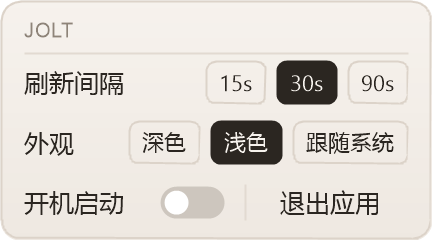
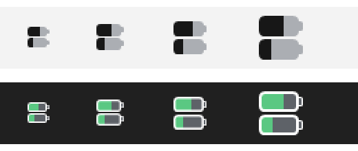
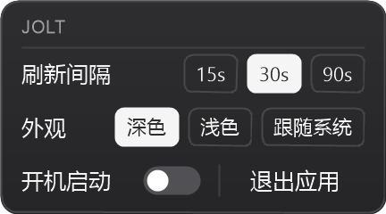
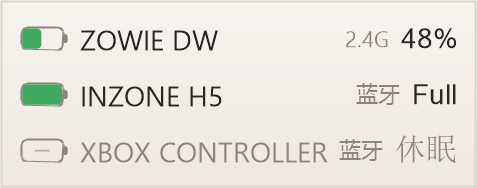

<p align="center">
  
</p>

<h1 align="center">Jolt</h1>

<p align="center">
  
  
  
  
</p>

Jolt 是一个 Windows 托盘电量工具：把无线鼠标、键盘、耳机的电量收在任务栏里，鼠标一悬停就能看到。它是 [Voltide](https://github.com/sdparklab/Voltide) 的独立分支（fork），沿用上游的设备适配架构，界面层是重新写的。

- 没有桌面面板，只在托盘占一个图标；左键或右键点开同一张紧凑设置卡。
- 托盘图标按设备数量显示 1–2 枚电池，配色跟随任务栏明暗，按 DPI 原生渲染。
- 悬停即看电量，不必打开设置卡。

## 截图

<p align="center"></p>

<p align="center"><em>左键或右键点击托盘图标，打开的就是这张设置卡：刷新间隔、外观、开机启动、退出应用。</em></p>

<p align="center"></p>

<p align="center"><em>托盘电池图标：16 / 20 / 24 / 32 px（图中放大两倍）。上排为浅色任务栏，下排为深色任务栏。</em></p>

<p align="center"></p>

<p align="center"><em>外观选「深色」，或选「跟随系统」且系统为深色时，同一张卡片改用中性灰配色。</em></p>

<p align="center"></p>

<p align="center"><em>鼠标停在托盘图标上，浮层按行列出设备名、连接通道与电量；休眠设备保留最后一次读数并灰显。</em></p>

## 功能

- **常驻托盘，不弹窗口。** 程序只在托盘占一个图标，没有桌面面板；左键或右键点开的是同一张设置卡。
- **Windows 风格的托盘电池图标。** 图标按设备数量显示 1–2 枚电池，竖向堆叠，形态对齐系统电源图标：浅色任务栏为灰底槽 + 黑色电量条、无描边；深色任务栏为白色描边 + 绿色电量条。配色跟随**任务栏**明暗（而不是应用主题），没有设备时回退为应用图标。
- **按 DPI 原生渲染。** 以 Per-Monitor V2 声明 DPI 感知，按任务栏所在显示器的 DPI 重新绘制（100% / 125% / 150% 下分别是 16 / 20 / 24 px，最高 32 px），缩放变化或任务栏移到另一块显示器时会重画，不会被系统拉糊。
- **悬浮查看电量。** 鼠标停在托盘图标上弹出浮层，按行列出设备名、连接通道（2.4G / 有线 / 蓝牙）与电量；休眠设备保留最后一次读数并灰显。浮层电池条 15% 及以下为红色，30% 及以下为黄色，其余为绿色。
- **右键设置。** 刷新间隔（`15s / 30s / 90s`）、外观（深色 / 浅色 / 跟随系统）、开机启动与退出应用，全部收在同一张紧凑卡片里，选择会被记住。
- **浅色与深色共用一套 fluent 语言。** 浅色为米白卡片，深色为中性灰卡片，字色与分隔线同步调整；「跟随系统」会在 Windows 切换主题时实时跟随。
- **单文件发布。** 无安装程序，除 Windows 自带的 .NET Framework 外无其他依赖。

## 与上游 Voltide 的关系

- 本项目 fork 自 [sdparklab/Voltide](https://github.com/sdparklab/Voltide)，基线为上游 v2.1.5（`c1872c4`）。
- 设备适配（`src/Providers`、`src/Interop`、`src/Core`）最初来自上游。Jolt 也接受贡献者在自己设备上验证过的适配 PR。
- 界面层（`src/UI`、`src/Program.cs`、托盘交互、DPI、构建脚本）是 fork 自己的实现，与上游差异较大，所以**不向上游提交 Pull Request**，作为独立分支维护。

同步上游设备支持：

```powershell
git remote add upstream https://github.com/sdparklab/Voltide.git   # 只需一次
git fetch upstream
git merge upstream/main
```

同步时请核对两边对同一型号的改动，避免重复注册适配器。

## 用自己的设备贡献适配

手边有一台设备就可以参与。先在 GitHub 上 fork 本仓库，在连接设备的 Windows 电脑上克隆自己的 fork，用能操作本地终端的编程 agent 打开仓库根目录，把下面这段话发给它，填入型号和当前连接方式即可。

> 请按 `docs/device-adaptation-prompt.md` 为我手边的【品牌和完整型号】适配电量读取。现在用【2.4G 接收器 / 蓝牙 / USB 有线】连接。需要我唤醒设备、切换连接或查看厂商软件读数时告诉我。验证通过后，请把改动推送到我的 fork，并向 `Daieenbo/Jolt` 的 `main` 分支提交 PR，返回链接。

如果 agent 无法直接读取仓库文件，可以复制[完整适配提示词](docs/device-adaptation-prompt.md)发给它。提交 PR 时需使用有权推送个人 fork 的 GitHub 账号。

## 当前已支持

以下设备均已在真实硬件上验证。它们代表作者手头拥有的设备，而非架构所能覆盖的上限。

| 品牌 | 设备 | 匹配 | 协议 |
|---|---|---|---|
| 罗技 Logitech | G304 / GPW3 / M750M / G102 / Unifying | VID `046D` | HID++ 2.0 |
| 迈丛 MCHOSE | K99 v2、G75 Pro | `3554:FA09` | 20 字节帧 |
| 迈丛 MCHOSE | Z75S | `258A:01BB` | 20 字节帧 |
| 迈丛 MCHOSE | K7 V2 Ultra+ | `3837:1014` | 64 字节 |
| 迈丛 MCHOSE | A5 V3 | VID `3837` | 65 字节 Feature |
| 迈丛 MCHOSE | A7 Ultra | VID `5253` | 厂商自定义 |
| 迈丛 MCHOSE | V9 Turbo+（耳机） | — | 厂商自定义 |
| ROG | AZOTH EXTREME（夜魔 Extreme） | `0B05:1ACE` | 64 字节帧；Omni 键鼠分离（实验性） |
| ROG | Delta II、Pelta（耳机） | VID `0B05` | 64 字节，0xFF00 |
| 雷蛇 Razer | 毒蝰、炼狱蝰蛇、巴塞利斯蛇等 24 款无线鼠标 | VID `1532` | 91 字节 Feature |
| 雷蛇 Razer | 旋风黑鲨 V2 专业版 | `1532:0555` | 64 字节音频通道 |
| ATK | A9 Air 大师+ / F1 V3 Ultimate+ | `373B:1278` | 17 字节，和校验 0x4D |
| ATK | N9 V2 Ultimate（耳机） | `373B:1262` | 64 字节，report 0x55 |
| VXE | R1 | `373B:10C9` | 17 字节（Compx 方案） |
| 泰度 TAIDU | TSG809 | VID `A8A5` | 厂商自定义 |
| IMECOO | P1 | `3554:FB34` | 17 字节 |
| 前行者 EWEADN | S9 Pro | `372E:103D` | 厂商自定义 |
| 前行者 EWEADN | A5 Pro | `258A:0138` | 520 字节 Feature |
| XIBERIA | T7（耳机） | `36F9:F008` | 64 字节 |
| CROCIRIS | X7 | `36F9:AA20` | 厂商自定义 |
| 雷柏 RAPOO | VT3S | `24AE:1411` | 64 字节 |
| 达尔优 DAREU | A950 AIR V2 | — | 厂商自定义 |
| ZOWIE | EC2-DW 等 DW 系列 + 4K 增强接收器 | `04A5:800A` | 16 字节帧（0xFF03 / 0xFF04） |
| Sony | PS5 / PS5 EDGE | `054C:0CE6` / `0DF2` | HID |
| Sony | INZONE H5（耳机） | `054C:0EBF` | 64 字节 HCI，0xFF04 |
| Xbox | Series X\|S、8BitDo 等 XInput 手柄 | 槽位 0–3 | 四档电量（蓝牙 LE 为 GATT 精确值） |

> 上游与 fork 新增设备的适配由以下网友在真实硬件上逆向并验证：
> [@RealRayTan](https://github.com/RealRayTan)（PS5）、
> [@Yim-7](https://github.com/Yim-7)（XIBERIA T7、CROCIRIS X7）、
> [@CLR0512](https://github.com/CLR0512)（VXE R1）、
> [@waitter-01](https://github.com/waitter-01)（MCHOSE V9、DAREU A950）、
> [@HSOTrany80](https://github.com/HSOTrany80)（MCHOSE A7）、
> [@study-yang](https://github.com/study-yang)（EWEADN S9 Pro）、
> [@LinWeiLong](https://github.com/LinWeiLong)（雷柏 VT3S）、
> [@yuanmie](https://github.com/yuanmie)（EWEADN A5 Pro、Z75S）、
> [@znc15](https://github.com/znc15)（ROG Omni 键鼠分离）、
> [@WeiqiaoCode](https://github.com/WeiqiaoCode)（刷新间隔崩溃修复）。
>
> 一并致谢的早期贡献者：[yiwluoq](https://github.com/yiwluoq)（ATK）、[Mor16rty](https://github.com/Mor16rty)（IMECOO、Xbox）、[whitzard0421](https://github.com/whitzard0421)（K7 V2 Ultra+）、[koobzx](https://github.com/koobzx)（A5 V3）、[ptaritsu](https://github.com/ptaritsu)（TAIDU）、[Cantrarella](https://github.com/Cantrarella)（ROG Delta II / Pelta）。
> 雷蛇与狼蛛协议的逆向由 B 站网友 木兮丶念旧 完成并分享，一并致谢。

## 使用方法

1. 从 [Releases](../../releases) 下载 `Jolt.exe`。
2. 运行。程序常驻托盘，不弹窗。不要把 `Jolt.exe` 放在受沙箱保护的目录里（见「已知限制」），否则托盘图标无法注册。
3. 左键或右键点击托盘图标，打开设置卡：刷新间隔、外观、开机启动、退出应用。
4. 鼠标悬停在托盘图标上可快速查看每台设备的连接通道与电量。
5. Win11 下新图标默认收在任务栏的「^」溢出区，把它拖到任务栏上即可固定。

无需安装、无后台服务、无需管理员权限。

### 如何理解悬停浮层

| 显示状态 | 含义 |
|---|---|
| 已填充的电池条 + 彩色百分比 | 设备在线并正常上报 |
| 空心电池条 + 灰色「休眠」 | 设备休眠；若曾上报过，数值为最后一次读数 |
| 空心电池条 + `--` | 设备处于休眠，且从未上报过 |

### 设置

- **刷新间隔** —— 设置卡里的三个选项（`15s / 30s / 90s`），默认 90 秒，选择会被保存并在下次启动时恢复。
- **外观** —— `深色` / `浅色` / `跟随系统`；写入当前用户注册表（`HKCU\Software\Jolt`），「跟随系统」实时跟随 Windows 主题。托盘图标的明暗只跟随任务栏，不受这里影响。
- **开机自启** —— 同一张卡片里的开关，写入当前用户的启动项（`HKCU\...\Run` 下的 `Jolt`），无需提权。

## 系统要求

- Windows 10 1903 或更高版本，或 Windows 11
- .NET Framework 4.8（上述系统已内置）
- 高 DPI：按 Per-Monitor V2 声明 DPI 感知；Windows 10 1607 以前会退回系统级 DPI 感知

## 构建

```powershell
# 编译（使用 Windows 自带的 C# 编译器，产出 Jolt.exe / Jolt-Test.exe）
powershell -ExecutionPolicy Bypass -File build.ps1

# 生成可分发的单文件版本（默认输出到 dist\）
powershell -ExecutionPolicy Bypass -File pack.ps1 -Target dist
```

- `Jolt-Test.exe --test` 会在控制台打印当前枚举到的设备与原始报文，便于新增适配时核对。
- 若仓库内存在 `Fonts/` 目录，`build.ps1` 会把字体作为清单资源嵌入 exe；当前仓库不含字体文件，未嵌入时回退到系统字体。
- `run.cmd` / `run.ps1` 用 `Add-Type` 把源码编译到内存直接运行，不落盘 exe，适合开发时试跑；但它无法引用 WinRT 元数据，因此**不含蓝牙 LE（Xbox 手柄）路径**，正式版本请用 `build.ps1` 或 `pack.ps1`。

## 协议说明

这些协议均非厂商公开。各帧格式已写在对应适配器的文件头注释中。

- **罗技** —— HID++ 2.0。特性 `0x1004` 的功能 1 返回百分比；老款接收器回退到特性 `0x1000`。
- **迈丛** —— 报告 `0x13` 上的 20 字节帧。命令 `0x4A`，第 5 字节为百分比，第 19 字节为前序字节的模 256 校验和。
- **ROG** —— 向接收器的厂商集合（用途页 `0xFF00`）写入 64 字节帧 `02 12 01`。回复的第 6 字节为百分比，第 10 字节为设备上配置的低电量阈值。
- **ZOWIE** —— 向接收器的厂商集合（用途页 `0xFF03`）写入 16 字节帧 `08 B4 15`，回复来自用途页 `0xFF04` 的 16 字节输入报告，第 1–2 字节为大端电压（单位 0.01 V）。协议没有原生百分比与充电位；百分比按鼠标 LED 档位对应的电压锚点插值，属于估算。另用 `B4 40` / `B4 25` 读取接收器与鼠标固件版本，靠命令前后版本是否一致判断鼠标是否真的在线——鼠标关机后接收器仍会返回旧电压。
- **Sony** —— INZONE 耳机走 Sony HCI（opcode `0xFC00`），封装在用途页 `0xFF04` 的 64 字节报告中。电池事件 `0x04`，回复载荷第 1 字节为充电标志，第 2 字节为百分比。
- **Xbox（蓝牙 LE）** —— 手柄以 HOGP 连接时，XInput 返回 `type 0` 看不到电池，于是改读蓝牙 GATT 电池服务（`0x180F` / `0x2A19`）。GATT 只给百分比、没有充电标志，充电状态靠「15 分钟内从 ≤95% 跳到 100%」推断。

有一处值得记录的陷阱：罗技 `0x1004` 的**功能 0** 返回的是电压而非电量——设备空闲时它恒定为 3.85 V，与真实电量无关。返回百分比的是功能 1（`0x1E`）。早期版本读取功能 0，这正是 Voltide 显示数值与 G HUB 不一致的原因。

## 已知限制

- 从未上报过电量的设备在休眠时无法被查询唤醒，将显示 `--`，直至被使用。
- **ROG Omni 键鼠分离为实验性功能**：已实现配对表读取与按报告 ID 分通道查询，作者在 Strix Scope II 96 Wireless + Harpe Ace 上验证过（100% / 3%）。若接收器配对表无应答，会回退到只读键盘通道；覆盖的鼠标型号仍有待补充。
- 共享同一接收器的无线设备通过接收器上报，而非各自独立上报。
- 同品牌但不同型号的设备会被识别为现有型号。适配层目前按厂商与接口特征匹配，尚未区分具体型号。
- 迈丛与狼蛛共用 USB 标识（`3554:FA09`）。目前仅适配迈丛的查询协议，狼蛛键盘可能被识别为迈丛型号，读数也可能不正确。两者需要通过监听设备主动上报来区分，尚未实现。
- XInput 手柄在**有线或非蓝牙**通道下只能读到**四档**电量（满 100% / 中 50% / 低 20% / 空 5%），不是精确百分比，浮层会标注 `XInput 四档`，避免误读为实测值。
- Sony INZONE 耳机关机后不再应答，卡片转为休眠并保留最后一次读数。
- ZOWIE 的百分比由电压插值估算，不是设备原生读数；无线 + 底座充电时无法判断是否在充电，只有鼠标插线（切换为 `04A5:800D`）时卡片才显示「USB 已连接（推定充电）」。
- 蓝牙 LE（HOGP）连接的 Xbox 手柄：百分比是系统读数而非四档估算，会随系统蓝牙栈刷新而跳动。GATT 没有充电标志（HID 描述符里也没有电池字段），因此充电状态只能推断：手柄接墙充时蓝牙仍保持连接，但固件会把电量固定报成 100%（实测 4 分钟内从 68% 跳到 100%），应用检测到这种跳变后显示「电池充电中」并沿用上一次真实百分比；若应用是在充电过程中启动的，没有更低的历史读数可比，首轮仍会按 100% 显示。
- 托盘图标在浅色任务栏下没有描边（与 Windows 电源图标不完全一致），这是当前 fork 的既定样式。
- 托盘图标依赖 Windows 外壳接口：如果 `Jolt.exe` 位于受沙箱或受管制的目录（例如 DSH 工作区 `D:\dshDesktop\DSH-WorkSpace`），从该目录启动的进程会被降为低完整性级别（Low IL），Windows 会拒绝它注册托盘图标。此时程序会弹窗说明并退出，而不是静默运行。把 exe 放到普通文件夹（例如 `D:\Jolt\`）后运行即可。
- 单实例运行：重复双击不会弹出第二个图标，也不会把已隐藏的菜单调出来。

## 许可

MIT，详见 [LICENSE](LICENSE)。

原始设计与设备协议逆向：[Joko](https://github.com/sdparklab) / [Voltide](https://github.com/sdparklab/Voltide)。
fork 维护：Daieenbo。
